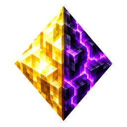

<div align="center">



# Relíquias Launcher

Launcher oficial do **Relíquias SMP** · Minecraft 1.21.1 · NeoForge

[](https://github.com/JoaoGB474/reliquias-launcher/releases/latest)
[](https://github.com/JoaoGB474/reliquias-launcher/releases)
[](LICENSE)

### [⬇ Baixar para Windows](https://github.com/JoaoGB474/reliquias-launcher/releases/latest/download/Reliquias-Launcher.exe)

</div>

---

## Como jogar

1. Baixe o `Reliquias-Launcher.exe` e abra. Não precisa instalar.
2. Entre com a sua conta do Discord.
3. Clique em **Jogar**.

O launcher cuida do resto: Java, Minecraft, NeoForge e todos os mods, sempre na versão do servidor.

## 🛡️ Apareceu uma tela azul?

<div align="center">

</div>

<br>

É o **SmartScreen**, o segurança da porta do Windows. Diante de um programa que nunca viu, ele faz duas perguntas:

> 🪪 **"Quem fez isso?"**
> Pra responder, o programa precisa de um crachá comprado de uma empresa que confere a identidade do autor. O launcher é de um servidor de amigos e não tem esse crachá pago.

> 👥 **"Muita gente já usa?"**
> O launcher é novo e só a galera do servidor baixa. Pro Windows, ninguém usou ainda.

Sem crachá e sem fama, o segurança não barra, só avisa: *"não conheço esse cara"*. **Não é vírus.** É o Windows dizendo que não conhece o programa.

Clique em **Mais informações → Executar assim mesmo** e pronto. Isso só acontece na primeira vez.

## O que ele faz

| | |
|---|---|
| 📦 **Tudo automático** | Instala Java, Minecraft, NeoForge e o pacote de mods. |
| 🔄 **Sempre em dia** | Atualiza o pacote e o próprio launcher a cada abertura. |
| 💬 **Login pelo Discord** | Sem conta extra: a whitelist é a do servidor. |
| ⚡ **Downloads retomáveis** | Caiu a internet? Continua de onde parou. |
| 🔒 **Verificado** | Cada arquivo é conferido por SHA-256; atualizações levam assinatura Ed25519. |

## Privacidade e segurança

- Os tokens ficam só no Gerenciador de Credenciais do Windows, nunca em arquivo.
- A conexão com o servidor usa pinning de certificado.
- Detalhes em [PRIVACY.md](PRIVACY.md).

<details>
<summary><b>Para desenvolvedores</b></summary>

### Estrutura

- `core/`: biblioteca Rust e CLI `rl` (login, sincronia do pacote, instalação, lançamento do jogo).
- `app/`: aplicativo desktop em Tauri 2, com interface em Svelte 5 e Vite.
- `vendor/`: dependência `self-replace` usada na autoatualização.

### Requisitos

Rust 1.88 ou mais novo e Node.js. No Windows, WebView2 (Windows 10/11).

### Build

```powershell
cargo test --workspace
cargo clippy --workspace --all-targets -- -D warnings
cargo fmt --check
cargo build --release -p launcher-core
```

CLI:

```powershell
cargo run -p launcher-core -- login
cargo run -p launcher-core -- sincronizar
cargo run -p launcher-core -- lancar --dry-run
cargo run -p launcher-core -- verificar
```

Aplicativo:

```powershell
cd app
npm ci
npm run tauri build
```

### Configuração do build

Valores públicos, embutidos na compilação (não contêm segredos):

| Variável | Conteúdo |
|---|---|
| `RL_SERVIDOR` | `host:porta` da API. |
| `RL_SPKI` | SHA-256 do SPKI do certificado do servidor (64 caracteres hex). |
| `RL_DISCORD_CLIENT_ID` | ID público da aplicação Discord. Sem ele o login falha antes de abrir o navegador. |
| `RL_UPDATE_PUBKEY` | Chave pública Ed25519 das atualizações, em base64. Sem ela a autoatualização fica desligada. |

### Linux

O build sai do GitHub Actions (workflow `Linux`) como AppImage e `.deb`. Para compilar à mão, instale `libwebkit2gtk-4.1-dev`, `libayatana-appindicator3-dev`, `librsvg2-dev`, `libgtk-3-dev` e `patchelf`, e rode `npx tauri build --bundles appimage,deb` em `app/`.

No Linux a sessão fica em `~/.config/Reliquias-Launcher/sessao.json` (modo 0600), os dados em `~/.local/share/Reliquias`, e a autoatualização do launcher é desligada: baixe a versão nova.

</details>

---

<div align="center">

Código aberto sob a licença [MIT](LICENSE).

</div>
